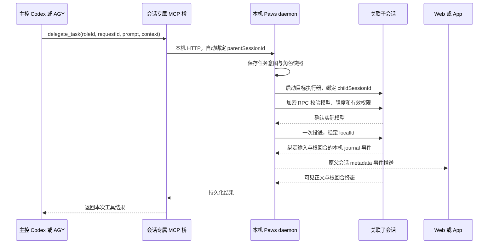

# 跨 Agent 子任务委派

Codex 或 AGY 保持当前会话的主控身份，通过 Paws 保存的角色，把有界任务交给同一台机器上的 Codex 或 AGY。子任务的进度、交接材料和各版结果归属于原会话；主控正常收到工具结果后继续核对和整合。

## 使用方式

在新会话用自然语言创建角色，例如“创建写作助手，使用 AGY 的某个实际可用模型，负责文章和 README 的候选稿”。主控通过 `agent_roles` 保存配置；也可以从输入框上方的助手入口管理名称、用途、执行器、模型、可选强度与自动选择开关。角色在同账号、同机器复用，无需独立设置页。

主控首次处理任务时读取角色目录。用户明确指定的角色优先；只有 `autoDelegate=true` 的角色允许按用途自动匹配，关闭后需要用户明确要求。此选择由主控模型依据工具说明和用户要求完成，daemon 不用关键词正则猜测任务类别。

`delegate_task` 创建任务时用 `roleId`；修改同一任务时用返回的 `taskId` 和新的 `requestId`。网络重试沿用原 `requestId`，不能因为等待失败就新建另一份。助手管理的“使用”和任务详情的“追加修改”只预填主输入框，由用户补充并发送。

## 路径与身份

Web/App 的角色管理、结果读取和取消，通过已有加密机器 RPC 调用相同协调器，不经过本机 HTTP。模型调用使用会话专属 MCP → 本机 HTTP。两种入口复用协调器和已有会话启动函数，不新增 Server API。

角色 ID 是配置身份，taskId 是一件工作的身份，childSessionId 是执行历史身份。任务保留角色及路由快照；后续编辑或删除角色不修改已存在任务的路由。每版输入具有 requestId、version 和 nonce 绑定，只有包含精确 localId 的单个根回合能提交结果。原生内部子代理、思考文本和无关回合不能混入交稿。

## 完成、等待与恢复

- 状态为 `starting`、`running`、`waiting-for-input`、`completed`、`failed`、`cancelled` 或 `interrupted`。启动进程不代表任务完成，取消请求也不代表已停止。
- MCP 默认以事件等待最多十分钟；需用户输入、终态或超时后正常返回。已经返回的工具调用不会被迟到结果改写。`read_delegated_task` 只读取该父会话的一个任务快照，不能读取任意聊天历史。
- 子 worker 写入权限受保护的本机 journal，daemon 通过文件事件接收；断线重连重新发布已知父会话快照。显式刷新与启动恢复是单次读取，无业务状态轮询。
- 本机仍保留父会话密钥与身份记录时，原父会话结束或归档后也可读取其已有任务的已确认结果；读取不会拉起执行器。恢复仍存活的执行器时，重新核对保留身份、加密 RPC 和原生配置。密钥记录沿用 Paws 现有保留策略，不额外承诺无限期在线读取。
- 同任务修订复用仍存活的 child。worker 退出后不自动启动替代会话，不承诺 AGY 历史恢复；已确认结果仍持久保留，未确认执行标为 interrupted。
- 取消优先移除精确排队输入，否则核对当前根回合和输入身份后请求原生停止。只有实际回执才能记录 cancelled；失败或结果不确定不会伪造成功。

## 首版边界

两个执行器使用各自已有认证与额度，不能转移 Codex 额度。模型和强度必须来自目标执行器实际目录，未知或不支持时明确失败。跨执行器权限仅支持可等价映射的完全访问；无法保留受限文件策略时拒绝委派，不静默提高权限。

首版仅支持同机，沿用原项目目录；它不提供操作系统隔离，也不保证并发写同一文件安全。建议写作助手交候选文本，由主控核对后写文件。应用绑定、sandbox 会话及子任务递归委派不在支持范围。任务结果是执行器的可见正文，最长 64,000 字符并明确标记截断；不自动采集文件，也不把交稿完成表示为已验收或已保存。

执行端和主控 worker 都需要声明委派能力。旧运行会话不会热加载新工具，界面会提示新建支持该能力的会话。
