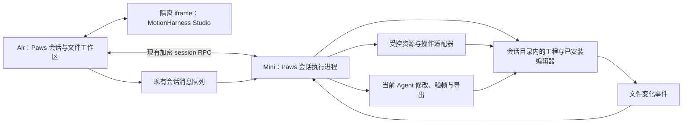

# Paws 动画工作台集成

用户于 2026-11-26 选择「先内嵌 MotionHarness，Paws 接管 AI 回改」。本实现沿用 MotionHarness 的画布、轨道、编辑与标注，在当前 Paws 会话中选择标注并排队交给 AI。工程与渲染运行在执行机，浏览器通过现有加密会话访问。

实现和实际发布状态以[本次发布记录](../validation/motion-workbench-release-20261126.md)为准。用户已接受 V2 上下文产物方向；本次将其接入真实工程、加密会话关联和 AI 回改，而非发布静态演示页。

入口来自右侧本会话影片、输入区「项目产物 / 关联产物」及项目的产物页，不在每个会话标题栏常驻剪辑按钮。静态交互稿保留在[原位交互稿 V2](motion-project-entry-v2/REVIEW.md)，其中演示数据不进入正式产品。

当前项目入口仍复用一个已有在线执行会话作为目录授权和传输绑定；尚未选择时提供明确的会话选择入口。打开工程与选择 AI 协作会话分别处理，打开和关联均不发送模型要求。完全脱离会话的机器级工程打开留作后续实现，不将这一能力记为已上线。

## 归属与传输

- 原生工程文档、素材、构建、历史和导出以执行机为权威；Paws 不另存可覆盖文档的编辑副本。
- 绑定属于 server/account/machine/session/project；工程 ID 本身不授予访问权。
- 第一版只接受当前会话根目录或子目录。启动工具前解析 realpath，拒绝父目录、同名前缀兄弟目录、符号链接逃逸和指向外部的工程配置。
- 当前 Paws 源码会话不能因此修改旁边的影片。影片必须从以该工程或其父目录为根的会话进入；不扩大既有文件 RPC 范围。
- Air 的 `127.0.0.1` 仍指 Air。原生 loopback 地址和访问 token 留在 Mini，不能作为跨设备接口或任意 URL 代理返回。

## 用户入口与状态

PC Web 的能力中心展示本会话明确关联的影片卡片；输入区与项目产物页提供通用的产物入口。普通会话不扫描或自动关联同目录影片；用户打开选择器时才发现候选，打开工程和关联到会话是独立操作。文档和导出视频继续从已有项目文件入口查看，不伪造通用多类型产物登记库。

关联写入现有加密会话 metadata 的 motionProjectLinks，最多20条，按会话、账号、执行机和工作目录校验所有者，CAS冲突时合并最新值。清除当前修改对象不删除关联；解除关联不删除原工程或其他会话的引用。原生文档、媒体、历史继续由引擎保存。

打开工程时自动启动或复用执行机已安装的 MotionHarness；不随Paws启动批量运行影片服务。只有选择AI协作会话并明确发送标注/导出要求，或从输入引用条发送修改文字，才把已冻结的工程与版本交给指定会话。协作会话必须在线、属于相同执行机，且其目录允许访问原工程。新会话创建成功但暂未载入时，重试连接原ID，不重复创建。

文件工作区保留原入口：目录含 `mh.json` 时显示「打开剪辑工作台」；打开这一入口文件默认直接进入剪辑器，标签跟随原生工程名称，缺名时回退到工程目录名。剪辑模式收起文件保存、下载与路径工具栏；「代码」是查看原配置的显式入口，选择代码后不会被事件刷新自动切回剪辑，再次从「剪辑」入口选中该工程则明确返回工作台。只读档案、未选择会话及未保存的配置文件不自动进入编辑器。切换工程被原生草稿阻止时，返回原工程并保留输入。非 Web 平台使用空实现，不新增原生视频编辑器或 Tauri 能力。

产物选择器复用 `DesktopDialogFrame` 和 `WorkspaceButton`，为无正文草稿的模态选择器；明确关闭、Escape 与遮罩退出由现有模态宿主承载，内部搜索不触发发送。切换会话、账号、工作目录或卸载后丢弃旧回包；关闭列表也使在途刷新失效。搜索与表面使用当前主题的语义变量；组件和原生引擎验证已通过；本次真实浏览器与设备结果沿发布记录单独维护。

工作台延续文件工作区宽度、按钮、Typography 与当前主题语义表面。画布和影片原色保持原样；原生 Studio 根据当前明暗主题切换。加载、离线、出错、源码已更新、标注过期和已加入会话均有状态反馈。新入口复用现有多栏布局，不新增 AI 登录或第二个任务队列。

原生构建变化与 Agent 完成事件按任意顺序到达时，工作台在确认无未保存输入后重新载入完整构建，并恢复当前工程的播放时间。每个宿主只自动尝试一次；有草稿时保留原编辑器和显式「载入新版本」入口。恢复时间绑定会话与工程，不带入另一个工程；不以忽略 buildId 的方式复用旧源码，也不引入状态轮询。

操作路径：

1. 打开工程，接收受校验的编辑器包、完整文档与工程素材，在隔离 iframe 中显示真实原生画布和轨道。
2. 原生编辑与标注写回同一工程；打开 AI 标注面板前先等待当前保存，未确认表单会拦截操作。
3. 用户选择待回改标注，发送前重新读取文档、构建、完整标注快照和选中 requestVersion。
4. 通过现有 `stageSessionMessage` 排队一次，聊天展示原评论摘要。准备、发送及 Agent 结束都不自动代表用户验收。
5. Agent 按结构化请求重新核对版本、修改、验帧/音频并仅完成已验证的 requestVersion。
6. 文件事件和现有 Agent 完成事件触发一次刷新；源码构建变化后显示「加载新版本」。标注面板旧列表必须刷新后才能再次发送。

切换普通文件标签时保留同一 iframe，隐藏时暂停播放。关闭、回到源码、替换工程和加载新版本都先经过原生 `prepareProjectReopen` 与 transport flush。Web路由离开与项目会话行/新建动作等待原生保存确认；拒绝时保留编辑器，异步确认之后重新校验所有者。播放位置按账号、执行机和工程保存。完整刷新时未确认表单恢复仍未承诺；真实浏览器结果沿发布记录维护。

## 工程发现与登记

- 工程发现沿用会话根目录的真实路径边界，不扫描整机、不搜索兄弟目录，也不因登记记录而授予目录外访问权。原有独立影片若在源码工程旁边，应进入以影片或其父目录为根的会话；本版不是跨会话的全机影片库。
- 仅识别受支持的 Pro `mh.json`；跳过符号链接目录、隐藏目录及依赖、构建和缓存目录。每次发现最多 100 个工程、1000 个目录、10000 条目录项，深度最多 6；目录与索引均逐项读取，达到预算时返回 `truncated`，不把部分结果冒充完整列表。
- 私有索引在 CLI home 的 `motion-projects/<server + canonical workspace hash>/`，只保存工程路径与最后打开时间，不复制文档或保存素材。注册记录有界读取并重新经过原生工程校验，过期、缺失与越界记录不能打开工程。标题每次从真实 `document.json` 读取，缺名或不可读时回退目录名。
- 发现后自动登记，显式添加和原生工作台打开也登记；新建、解包或导入的工程在下一次打开/刷新列表时发现。列表打开期间已有 Agent 完成事件触发一次刷新，不设扫描定时器或状态轮询。
- 显式库入口使用会话与工程绑定的打开请求，能够从该配置的「代码」模式返回编辑器；沿用配置草稿、只读状态和原生表单的保护。

## 接口与限制

共享协议：`packages/happy-wire/src/motionWorkbench.ts`。CLI：`modules/motionWorkbench/`。Web：`components/motionWorkbench/` 与 `sync/motionWorkbench.web.ts`。

| 加密会话 RPC | 行为 |
| --- | --- |
| `motionWorkbenchList` | 严格空请求；在当前会话范围内发现并登记工程，返回名称、路径、修改/最近打开时间和部分结果标记，不启动引擎 |
| `motionWorkbenchRegister` | 重新校验并登记当前会话范围内的已有 Pro 工程，不启动引擎、不复制文档 |
| `motionWorkbenchInspect` | 从已安装原生 CLI 读取完整标注快照，附工程、文档、构建与标注版本指纹 |
| `motionWorkbenchPrepareReview` | 重新校验同一工程和选中版本，返回结构化 Agent 请求；不派发、不完成标注 |
| `motionWorkbenchOpen` | 在会话作用域内打开原生工程；返回客户端预先规划的 UUID 绑定、公开状态与资源清单 |
| `motionWorkbenchState` | 按已拥有的绑定获取当前完整公开文档与构建状态 |
| `motionWorkbenchResource` | 只传编辑器包或已知工程素材 SHA；每块最多 256 KiB，无任意路径或 URL |
| `motionWorkbenchOperation` | 原生编辑操作白名单；拒绝启动系统程序、工程导航和其他宿主操作 |
| `motionWorkbenchClose` | 释放 Paws 绑定与监听器；可取消尚在打开的同一绑定，不关闭用户共享的原生工程 |

- 每会话最多两个编辑器绑定，同时最多一个打开过程。客户端按账号、会话、工程与生命周期丢弃旧回包。
- 每个标签页保存本作用域的计划绑定 UUID；下次明确打开时清理该标签页留下的旧绑定，不关闭其他活动视图。
- 编辑器 gzip 包最多 8 MiB，解压最多 24 MiB；单素材 64 MiB，客户端素材预算 128 MiB，传输和缓存均有界。
- 素材内容按 SHA-256 和尺寸验证；Blob URL 由隔离 iframe 自己创建。iframe 没有 same-origin 权限，CSP 限制连接、媒体与字体来源，不开放网络代理。
- 子 iframe 创建 MessageChannel，父页面校验精确 window、随机 nonce 和唯一 port 后，才在该 port 发送文档与素材，避免导航后的 WindowProxy 接收能力。
- 当前标注快照最多 1 MiB/1000 条；一次回改最多 100 条。原评论和路径按 JSON 数据封装，不插值为 shell 命令。

原生工具由执行机 PATH、已有 NVM 安装或宿主 `PAWS_MOTIONHARNESS_BIN` 选择；运行时可用 `PAWS_MOTIONHARNESS_RUNTIME` 指定。远端请求不能修改二者。不自动下载或安装、不改全局 CLI、不重启生产 daemon。

## 事件与导出

Paws 宿主使用文件事件合并通知、已有会话完成事件、连接恢复和用户动作。没有周期业务状态查询。单次请求/关闭的超时与文件事件的 100ms 合并不是轮询。

安装版 Studio 原有的 view context 100ms 轮询在本次内存打包时替换为视图/播放订阅；使用事件式 ProjectSession，未使用原生 HTTP ProjectSession。原生导出预览界面因依赖轮询被禁用，原生 Agent hook 也停用；原生 Agent 标注模式保留。不能由此宣称第三方运行时所有代码均无轮询。

「交给 AI 导出 MP4」将保存后的工程身份、buildId、文档 revision 和输出设置交给当前会话。Agent 按工程既有渲染流程生成新文件、验证后通过 Paws 媒体工具交付。按钮表示任务入队，不表示已完成渲染或下载。本轮未验证内嵌宿主中的真实 AI 导出。影片版本/恢复由原生历史与检查点承载，不把文本 Artifact 版本接口当作影片版本库。

## 依赖与许可

当前适配器仅支持已安装 MotionHarness 0.1.8。Studio、Core 等模块声明 GPL-3.0-only，SDK 声明 MIT；Paws 声明 MIT。编辑器从用户已安装运行时临时打包，Paws 源码未复制原生编辑器或添加 MotionHarness npm 依赖。运行时原文件保持不变；包中保留 GPL 文本与修改说明，工作台可下载许可文本。

iframe、进程隔离或使用本机已安装包本身不裁定公开分发义务；公开产品分发前仍须确认适用许可、对应源码与第三方通知。本次没有恢复原始 TSX/Rust 仓库，也没有验证独立重建运行时。

## 验收

| Case | 必要通过标准 | 当前状态 |
| --- | --- | --- |
| M0-1 工程隔离 | 父目录、兄弟目录、symlink 和外部配置在启动工具前拒绝 | 自动检查通过 |
| M0-2 快照与回改 | 完整快照可读，旧 build/revision/requestVersion 不派发 | 单测与原生 CLI 通过 |
| M1-1 内嵌编辑 | Air 的完整 Paws 真实打开 Mini 工程，定位并保存 | Mini 完整 Paws 真实通过；Air 离线未验 |
| M1-2 AI 回改 | 在 Paws 标注、选中、排队，真实 Agent 改准目标并刷新 | Mini 工程改名及追加文字/视觉参数回改、新构建交接与重开通过；实际源码改写与 Air 未验 |
| M1-3 恢复与隔离 | 断线、刷新、切工程不丢草稿、不混账号/旧响应 | 关闭保护、重开、刷新及深色主题通过；断线/完整跨会话恢复待验 |
| M1-4 历史与交付 | 恢复原生版本并导出同一工程，Air 可播放 | 入口/请求接线；本轮未验 |
| M3 工程发现入口 | 工具栏按名称选片，自动发现/登记，选择时准备引擎 | 组件、真实文件系统与已安装引擎登记检查通过；新工具栏真实浏览器/Air 未验 |

用户于本轮明确批准本次临时隔离验收，保留长期正式环境默认。已在 Mini 的完整 App、独立账号/真实 CLI worker 与影片副本中完成两轮标注改名回改、真实加密边界拒绝、关闭保护、刷新重开及 Gingham 深色核验；录像已发送，临时环境已清理。Air 的 Tailscale 离线且 SSH 超时，当前设备尚未验收。没有推送、合并或发布；正式 Web 仍仅通过 main CI 发布到仓库规定 origin。

### 产物入口交互稿 V2（待评审）

根据用户对顶部空间及普通会话适用性的反馈，新增[产物与会话交互稿](motion-project-entry-v2/REVIEW.md)。影片归项目、会话按需关联；打开工作台与指定AI修改对象分别表达。此稿已完成静态代表路径验收，未替换本文件所述真实集成，不能据此宣称关系库、通用产物中心或正式服务已经接通。
