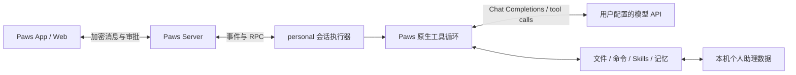

# Paws Personal：可行性、实现与使用

Paws 可以实现独立 personal agent。现有 App/Web、端到端加密消息、执行机 daemon、工具卡片、审批和会话恢复能够复用；模型调用、工具循环、身份、记忆和 Skills 由新 `personal` 引擎管理，不需要安装 Codex、Claude Code、OpenCode 或 OpenClaw。

第一版是按用户消息执行任务的个人助理。周期调度、外部消息渠道、邮箱身份和语音通话是独立集成，导入工作流不会自动获得这些能力。

## 架构



控制链路见 [runPersonal.ts](../packages/happy-cli/src/personal/runPersonal.ts)，模型与工具循环见 [engine.ts](../packages/happy-cli/src/personal/engine.ts)。Paws Agent SDK 的 `agent: 'personal'` 也能创建该执行器。

## 使用

在升级了该功能的执行机和客户端中，新建会话的 Agent/模型选项与 Agent 设置提供 **Paws Personal**。旧执行机未声明 `cliAvailability.personal` 时不显示该选项；现有对话的引擎保持不变。

```sh
# 安装用户提供的压缩包，不需要模型 Key
paws personal install-skills /absolute/path/grok-bot-skills.zip
paws personal skills

# 在当前工作目录创建 Paws Personal 会话，随后从 Paws 发送指令
paws personal

# 在同一执行机恢复原会话与本地历史
paws personal --resume <paws-session-id>
paws resume <paws-session-id>

# 本地单轮输出，不创建远程会话
paws personal --print '请读取当前目录中的说明并给出建议' --permission-mode read-only
```

`--print` 没有远程审批界面，默认拒绝命令执行和文件写入。只有用户显式指定 `--permission-mode yolo` 才绕过该执行审批。

## 模型配置和个人数据

本机目录默认是 `~/.happy/personal-agent`；可通过 `PAWS_PERSONAL_HOME` 指定独立身份目录。

| 文件 | 用途 |
| --- | --- |
| `config.json` | 模型接口、模型名、Key 环境变量名称和工具步数上限 |
| `IDENTITY.md` | 可编辑的助理身份与偏好说明 |
| `memory.json` | 跨会话保留的明确用户偏好，支持读取、记住和删除 |
| `sessions/<id>.json` | 当前执行机上的会话历史和工具结果 |
| `skills.json` | 当前激活的 Skills 清单与来源摘要 |
| `skill-bundles/<sha256>-v2/` | 不可变来源引用与 Paws 兼容入口 |

`config.json` 示例：

```json
{
  "baseUrl": "https://your-model-provider.example/v1",
  "model": "your-tool-capable-model",
  "apiKeyEnv": "PERSONAL_MODEL_KEY",
  "maxSteps": 16
}
```

环境覆盖为 `PAWS_PERSONAL_BASE_URL`、`PAWS_PERSONAL_MODEL`、`PAWS_PERSONAL_API_KEY`。Key 值只从环境读取；配置文件保存环境变量名称。远程接口要求 HTTPS，本机回环网关可使用 HTTP。未指定接口时复用现有 DeepSeek 配置；不会把该供应商的 Key 自动发给自定义网关。

记忆及模型历史保存在执行机上，使用受限文件权限，不会同步到其他机器。传给模型的上下文包含与当前任务有关的历史、身份、记忆、工作目录规则和按需读取的 Skills。

## Grok Skills 兼容性

上传包实际自述为从 Cursor managed-skills 目录复制的 52 个工作流。它们有可复用的业务知识，但包含 `CloudAgent`、`UpdateRoutine`、`SearchPlugins`、安全表单、Grok 邮箱等宿主专属指令。

导入器将入口命名为 `grok-<原名称>`，在 `SKILL.md` 中声明 Paws 兼容规则，将原字节保存在 `references/upstream.md` 并记录 SHA-256。原件只作业务参考，不作为新的宿主政策。压缩包不进入源码仓库或 npm 分发。

| 标记 | 本包数量 | 含义 |
| --- | --- | --- |
| `native-workflow` | 5 | 可用原生文件、记忆、命令工具执行其适用步骤，业务授权仍需满足 |
| `requires-ego` | 24 | 浏览器/演示工作流；先读 ego-ops，再按 ego-browser 使用真实 Ego 能力 |
| `requires-integration` | 23 | 需要日历、邮箱、调度、语音、渠道或其他实际接入；安装不代表接入完成 |

原生工具有 `list_skills`、`read_skill`、`read_file`、`write_file`、`run_command`、`memory_read`、`memory_write`。项目 `.agents/skills` 及本机已有的 Ego 两个治理/执行 Skill 也可被发现；其他 Codex 插件的工具不会因此自动进入该引擎。

浏览器只能使用 Ego，缺少 Ego 时明确停止该部分。外部服务未接入时不能声称完成订票、购买、发送消息或建立自动化。

## 执行和恢复边界

- `default`：允许读取与明确偏好记忆，命令和文件写入通过 Paws 审批；`read-only` 拒绝全部写入；`yolo` 绕过执行审批。其他 Agent 的绕过权限别名不自动升级 Personal 权限。
- 文件工具限制在工作目录与注册的 Skill 资源中，检查路径和符号链接；命令工具在工作目录启动，经过审批后拥有本机 shell 的能力，这不是操作系统沙箱。
- 模型每轮最多 16 次步骤（可配置 1–64）；API 单次超时 120 秒，命令超时 60 秒，输出有界。取消会传到模型请求、审批和命令执行。
- 工具调用在执行前落盘、结果在执行后落盘。进程异常退出时，未确认的工具结果记为“结果未知”，恢复不自动重放该调用。外部动作仍需核实后才能重试，不能保证跨崩溃的外部事务 exactly-once。
- 同一 Paws 会话恢复继续使用原 ID、本地历史和消息游标。原历史缺失时失败；不会静默创建一份空历史。恢复后等待实际 ready，再发送新消息。
- 现有 Server 将在线状态批量写入数据库，SDK 的发送前检查读取该持久化状态。快速停止再恢复时，SDK 可能在约 30–35 秒内仍报告 `SESSION_ARCHIVED`，即使 live presence 已恢复；本轮没有修改这套共享 Server/SDK 行为。显式恢复验收只做一次有界等待后读取，不增加状态查询循环。
- 引擎依靠用户消息和事件执行；新增定时器只发送会话在线心跳，不查询业务状态或扫描任务。没有启动后台业务轮询或调度服务。
- 当前入口是文本 Agent，不能宣称支持图片识别、语音、已连接的第三方 MCP 服务或全自动生活事务。

## 验证

```sh
pnpm --filter @wangjs-jacky/paws typecheck
pnpm --filter happy-app typecheck
pnpm --filter @wangjs-jacky/paws exec vitest run --project unit src/personal/personal.test.ts
pnpm --filter happy-app exec vitest run sources/utils/personalAgentRouting.test.ts

# 显式调用真实模型、加密 Paws 消息和会话恢复；需要已配置模型及本机 Paws 登录
pnpm --filter @wangjs-jacky/paws test:personal:live
```

离线测试使用真实本地 HTTP 服务、文件和命令，验证工具结果回传、权限拒绝、路径隔离、恢复不重放和 ZIP 安装。显式 live 验证覆盖真实模型读取/写入/跨实例记忆，以及 Paws 加密消息的原会话恢复。UI 自动测试与类型检查不等同实际浏览器点击或手机验收。

Skills 的标准结构和项目级发现方式参考 [OpenAI 官方 Skills 文档](https://learn.chatgpt.com/docs/build-skills)。该文档不证明 Grok 专属工具在 Paws 可用；能力结论以本引擎实际工具和运行证据为准。


## 独立个人对话入口

- “新建会话”下固定显示 Paws 圆形吉祥物头像与名称，桌面和手机侧栏均可进入 `/personal`。入口与聊天页的“修改助理”支持更名、上传头像及恢复默认头像。
- 名称与规范化的 256×256 JPEG 头像通过加密账号设置同步；续聊位置作为账号本地设置单独持久化。首次采用最近创建且未归档的 Personal 记录，此后始终打开已选 ID，即使它暂未出现在分页列表中；加载失败不自动创建另一段对话。
- Personal 拥有独立路由、消息布局、草稿与会话选择。底层复用加密会话和实时消息传输，其 flavor=personal 的记录从普通近期、时间线、清单、归档、命令面板和 Agent 空间列表中排除。历史链接及通知入口同样跳转至个人对话。
- 用户消息在右、助手回复在左；工具记录可折叠，待批准工具自动展示原有授权控件。消息发送、取消、流式输出和历史分页复用真实同步层；离开后再次进入继续原对话。
- 首次创建和断线恢复要求对应机器运行支持 Personal 的 CLI/daemon；安装独立 `paws-personal` 入口并不自动升级默认 daemon。原生手机布局代码与桌面共享，真机验证须另外执行。
