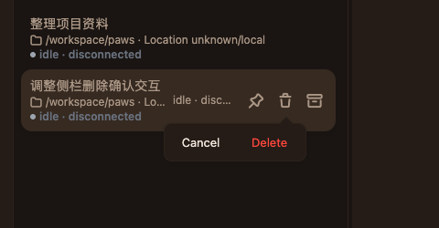

# 会话删除就近确认

用户已确认最终交互：左侧会话行及全局/项目对话顶部的垃圾桶，点击后在按钮附近显示带箭头的轻量确认，仅有 Cancel / Delete。没有标题、描述或页面变暗。

## 实现

复用原删除执行流程，确认后才停止会话、处理工作树清理、向服务端删除、本地移除并触发历史补位。取消、Esc、点击外部或滚动均收起；箭头对准触发按钮，视口底部自动上翻。打开行内确认时隐藏原悬停详情。切换顶部对话时清理待确认状态，切回不重开旧确认。手机及其他页面继续沿用原有确认流程。

## 实际截图

用户要求查看两个入口的修改后截图，已通过 Happy 图片工具发送，并批准合并上线；未要求前后对比矩阵或录屏。

左侧会话行：

全局对话顶部：

均为开发分支完整 App 的真实截图，使用隔离服务、合成账号和会话。顶部场景复用 project-goals 夹具，实际加密机器/会话 RPC 与项目解析，启动器为 stub，没有启动模型或生产 daemon。截图中的空白对话和项目任务为测试数据。

## 验证

- 46 项相关组件回归通过：ProjectConversationHeader、SessionDeleteConfirmation、SessionRowChrome、SessionActionsPopover、ActiveSessionsGroupCompact。
- happy-app typecheck 与 git diff --check 通过。
- Ego 实测两个入口：确认仅有 Cancel/Delete，箭头对准垃圾桶；取消关闭且保留会话，顶部对话仍保持打开。左侧另外验证 Esc。
- 未执行真实账号删除；手机原生行为、底部上翻的真实浏览器交互未验。
- 隔离服务及浏览器任务空间已关闭。

预览注意：项目分栏展开后需等布局稳定再点击，避免过时按钮几何误触相邻归档；仅测试合成会话受到影响。本次预览生成的 Expo 路由声明曾影响类型检查，备份生成文件并恢复启动前环境后通过；未修改业务路由或类型配置。

独立评审补验：项目首项变化可能复用同一菜单实例，原布尔确认态会切换删除目标；现将菜单和行内确认绑定会话ID，目标切换即清理，切回也不重开。对应回归已通过。
