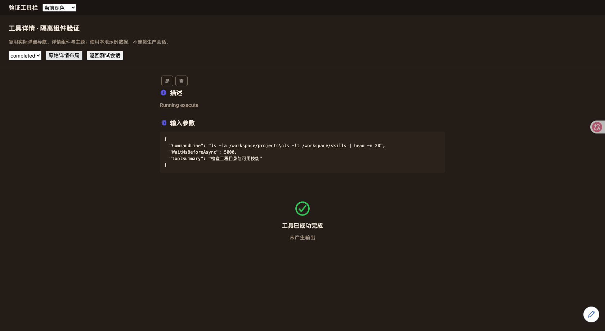
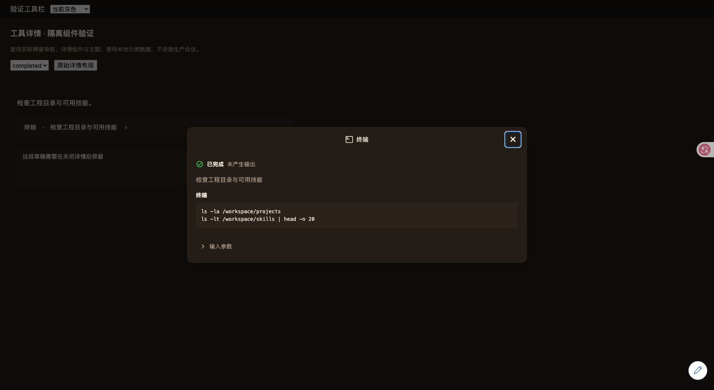

# 工具详情弹窗验收

2026-11-24。本文记录合并前的 Web 实现和隔离组件验收；正式发布及当前入口的复验另行记录。

## 来源与范围

- 用户提供工具详情截图和历史消息链接，明确要求避免整页平铺。
- 截图中的内容对应消息详情路由、`ToolFullView` 和 `PermissionFooter`。在 Ego 打开给定链接后被重定向至首页，未读取到目标详情；不据此判断会话已删除。
- 采用会话内弹窗是本次可逆的实现判断，未记录成用户长期布局偏好。
- 复用实际 React Navigation、`DesktopStackNavigator`、RN Web、原始及新详情组件、现有主题和 Ionicons 字体。浏览器夹具使用脱敏示例数据；授权调用只改变夹具内存，不连接生产会话。
- 复用已有桌面弹窗导航边界，保留背景路由身份和会话草稿。Web 内容实现通过 `.web.tsx` 隔离；没有修改 Android 详情实现或验证原生设备。

## 实现

- 桌面现有消息详情入口统一进入弹窗，直接详情 URL 恢复时补齐对应会话作为关闭目的地；窄屏仍走详情页面。
- 弹窗宽度最多 800；根据正文尺寸事件调整高度，最小 240、最大 640，受实际视口约束。仅当前详情的尺寸能更新弹窗，未引入轮询。
- 状态、摘要、命令和输出直接可读。完整输入参数及开发 JSON 默认折叠，展开时才生成参数/调试展示。
- 完成状态去掉大块成功占位；仅运行中且权限确实 pending 时显示审批。延续历史和只读上下文仍禁止审批。
- 保留有效的 `0`、`false` 输出，以及没有 result 时的失败详情、取消原因和专用编辑视图。
- 使用现有语义主题的 surface、surfacePressed、textLink、success 等角色。
- RN Modal 单独提供 dialog 语义。遮罩用非聚焦 View 响应指针，避免 RN Web 焦点陷阱把焦点移到无名称遮罩。

## 自动检查

在 `packages/happy-app` 执行以下检查，含 OTA 契约的 65 项通过：

```sh
pnpm exec vitest run \
  sources/navigation/desktopModalRouter.test.ts \
  sources/components/DesktopAppStack.test.tsx \
  sources/components/tools/ToolFullView.web.test.tsx \
  sources/components/tools/ToolFullView.historyRoute.test.tsx \
  sources/components/DesktopSettingsModal.test.tsx \
  sources/navigation/browserNavigation.test.ts \
  sources/utils/otaRuntimeConfig.test.ts
```

`pnpm exec tsc --noEmit --pretty false` 通过；`APP_ENV=production pnpm exec expo export --platform web --output-dir ../../artifacts/tool-detail-web` 通过。构建产物在当前 worktree 的忽略目录 `artifacts/tool-detail-web/`。

## Ego 浏览器结果

| 检查 | 观察结果 |
| --- | --- |
| 原始组件对照 | 复现整页参数、大块成功提示及完成后残留的权限区 |
| 短正文 | 1680×920 视口中弹窗 800×320，无重复状态图标 |
| 展开/收起参数 | 弹窗增高至 442 后恢复 320，完整参数可读 |
| 长输出 | 弹窗增高至 640 上限，滚动可读至最后一行 |
| 退出与重开 | 关闭按钮、Escape、遮罩均有效，草稿保留，焦点回到原入口 |
| 键盘 | Tab/Shift+Tab 在内容控件间循环，遮罩不接收焦点；只有一个 dialog |
| 权限 | pending 显示审批；夹具批准后进入“进行中”并移除按钮；完成及只读历史没有可提交的审批按钮 |
| 错误与输出 | 错误详情直接可见；`0`、`false` 的保留由自动回归覆盖 |
| 主题 | 浅色和非默认 ginghamDark 可读；非默认主题的普通、hover 和 focus 色来自对应主题 |
| 窄屏 | 700 宽度下使用页面，正文宽度 700，无桌面弹窗 |

原组件对照和最终稳定弹窗各一帧，通过会话绑定截图校验回传到 Happy Skills。截图仅证明隔离组件效果，未宣称用户原页面或正式入口已经加载新版本。夹具源码保留在当前 worktree 忽略目录 `artifacts/tool-detail-review/`，不是公开站点。

对照图使用同一视口、主题和脱敏示例数据，分别来自原始及新详情组件：

| 原始详情组件 | 优化后 |
| --- | --- |
|  |  |

## 验证中修正的问题

- 夹具根节点最初没有 flex 高度，导致滚动区域被裁切；修正测试容器后才采集有效对照帧。
- 模态淡出完成前立即读 DOM 会误判关闭失败；按面板实际消失验证。
- RN Web 焦点陷阱会尝试对后代逐个调用 focus。Pressable 遮罩即使设置 tabindex=-1 仍可能被程序聚焦；换成无 tabindex 的 View 后真实正反向 Tab 均通过。
- 独立代码评审补齐了终端输出和专用视图错误路径：stdout/stderr 通过已有 CommandView 保留实际换行，CodexBash 纯文本结果继续可读；专用编辑视图在协议同时记录 result 与 failure 时仍显示失败原因，取消原因也独立显示。新增回归覆盖这些实际数据形态。

正式站点与用户设备验收留待实际发布后执行。
