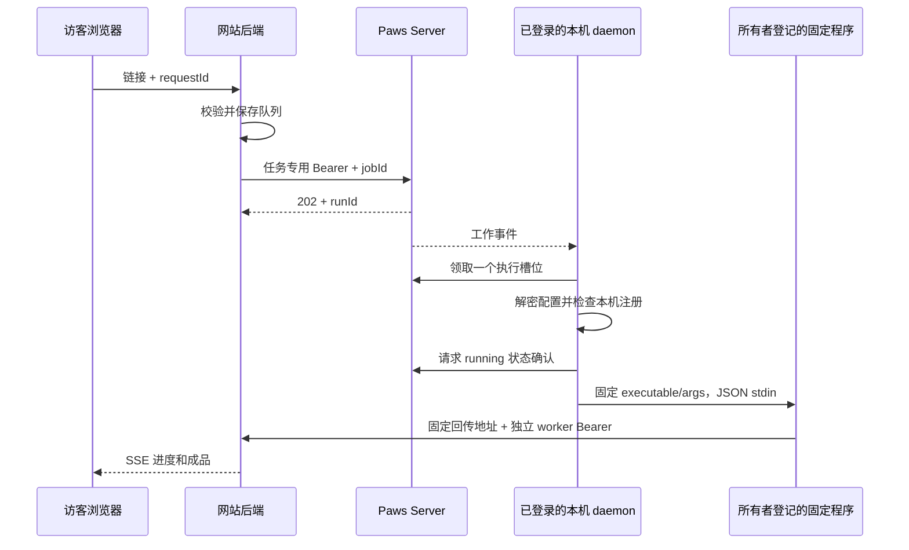

# 原话卡片网站

免登录提交 B 站链接 → 持久化 FIFO → Paws 任务 Webhook → 指定电脑上的固定程序 → 原视频画面、精选完整字幕段 → 页面进度、PNG 和 ZIP。

这是可独立部署的示例服务。不依赖原大麦图库的数据库、作者白名单或发布资源。通用执行协议与 B 站制作程序分开，其他任务可以注册自己的固定程序。基础证据见 [验证报告](../../docs/validation/video-card-studio-20261126.md)，下载及字幕修复见 [后续验证](../../docs/validation/video-card-studio-fixes-20261127.md)。

## 权限如何生效



访客不能选择命令、目录、模型、权限、回传地址或任意文本指令，也拿不到 Paws 账户 token。Webhook token 仅授权一个任务。网站后端与本机注册共同决定能做什么；即使网站凭据泄露，也不等于获得任意命令入口。

**固定程序具有 daemon 操作系统用户的权限，不是额外沙箱。** `permissionMode: read-only` 是兼容的任务配置字段，不限制本机注册的程序。程序、配置、注册表必须由可信所有者管理；需要更强的文件权限隔离时应使用独立系统用户或受限执行环境。AI 选段/选帧使用原生 Codex 的无工具结构化输出，禁止 shell、文件读取、联网和 bypass；源视频、字幕均作为不可信材料。

## 依赖

- Node 24（`node:sqlite`）、pnpm、同一版本的 Paws Server / CLI / happy-wire。
- FFmpeg / ffprobe、Pillow 和中文字体；Apple Silicon 实测的 MLX Whisper Python 环境。
- macOS 的画面字幕核对使用系统 Vision 与 Xcode Command Line Tools（`swiftc` / `xcrun`），OCR 本身无需下载模型。首次使用需已安装这些依赖；编译或复核失败会明确停止本次制作。
- 已登录的原生 Codex CLI。没有复制模型密钥，不会切换账号。
- Ego Lite 可用的桌面用户会话。当前采集方式依赖浏览器，不支持无桌面的 Linux worker。遇到登录、人机验证、目标变化或用户接管会停止。
- 当前密钥加载示例使用 macOS Account Pool / Keychain；不会降级为明文配置文件。异机部署网站时须为目标宿主另行接入安全凭据后端，不把 Keychain 导出到浏览器。

先按根 CLAUDE 安装和构建。生产升级沿正常发布流程；以下命令不会替换正在运行的正式 daemon。

## 配置与签发入口

本地注册脚本位于 `packages/happy-cli/scripts/configure-task-handler.mts`，必须由所有者在目标电脑运行。它使用现有 CLI 登录和机器 ID，保持现有机器加密格式，直接把签发的 Webhook token 写入 Keychain，不输出密钥。

准备三个**不含密钥**的配置文件。下面的绝对路径、UUID、Account Pool 安装目录和条目名均需替换为自己的值；任务 UUID 生成一次后保留，不在重试时换 ID。

`owner.json`：

```json
{
  "taskId": "47eb6972-7d14-47bc-b784-0da0062601df",
  "localHandlerId": "video-cards",
  "title": "原话卡片",
  "directory": "/absolute/private/card-worker",
  "executable": "/absolute/node24/bin/node",
  "args": ["/absolute/happy/examples/video-card-studio/worker.mjs", "/absolute/private/worker.json"],
  "timeoutMs": 2700000,
  "credentialStore": {
    "modulePath": "/absolute/account-pool-ops/scripts",
    "platform": "paws-card-studio",
    "entry": "webhook-v1"
  }
}
```

在仓库根执行：

```sh
pnpm --filter @wangjs-jacky/paws exec tsx scripts/configure-task-handler.mts create /absolute/private/owner.json
```

脚本建立关闭时间计划的任务、写入账户及 Server 作用域下的私有 `handlers.json`，再签发凭据。没有伪造未来日期，也不启动正式服务。已存在的任务 ID 会拒绝重复创建；部分失败时先检查脱敏结果，再使用 `rotate` 恢复，不能直接换 ID 重建。注册表以 0600 保存，保留其他任务的登记。

另为 worker 回传生成一个独立随机凭据，直接存入 Keychain。例如在自己的 Account Pool 脚本目录运行：

```sh
python3 - <<'PY'
import secrets
from account_pool import Pool
result = Pool().import_key('paws-card-studio', secrets.token_urlsafe(32), entry='worker-v1')
print({'stored': result['stored'], 'entry': result['entry']})
PY
```

`website.json`：

```json
{
  "dataDir": "/absolute/private/card-site",
  "taskId": "47eb6972-7d14-47bc-b784-0da0062601df",
  "pawsOrigin": "https://your-paws-api.example",
  "publicOrigin": "https://your-card-site.example",
  "host": "127.0.0.1",
  "port": 3000,
  "webhookCredential": { "modulePath": "/absolute/account-pool-ops/scripts", "platform": "paws-card-studio", "entry": "webhook-v1" },
  "workerCredential": { "modulePath": "/absolute/account-pool-ops/scripts", "platform": "paws-card-studio", "entry": "worker-v1" }
}
```

`worker.json`：

```json
{
  "siteOrigin": "https://your-card-site.example",
  "taskId": "47eb6972-7d14-47bc-b784-0da0062601df",
  "dataRoot": "/absolute/private/card-work",
  "workerCredential": { "modulePath": "/absolute/account-pool-ops/scripts", "platform": "paws-card-studio", "entry": "worker-v1" },
  "runtime": {
    "whisperPython": "/absolute/whisper-venv/bin/python",
    "renderPython": "/absolute/pillow-venv/bin/python",
    "font": "/absolute/chinese-font.ttc",
    "codexBin": "/absolute/codex"
  }
}
```

网站启动命令为 `node examples/video-card-studio/start.mjs /absolute/private/website.json`。本地验证可以省略 `publicOrigin` 并使用 loopback HTTP。公网必须是可信 HTTPS，反向代理须保留原始 Host、禁用 SSE 缓冲并配置连接/上传限额。当前匿名限流按 socket 的实际来源 IP；经代理时不能任意信任访客提供的转发头，默认会把该代理视为同一来源。

采集器默认为每次任务创建自己的 Ego 空间，成功采集后用独立调用结束；失败保留准确空间供检查，不自动换空间恢复。已有人工验证任务可显式提供 `browserContextPath`，文件包含数字 `spaceId`、`page`、准确 `targetId`、`expectedUrl` 和唯一 `runId`；这种空间归提供者收尾。首次导航若 B 站追加参数，严格 URL 校验会停止，需所有者观察确认后更新上下文，不会盲目接受当前标签。Happy 验证还可提供 `happyCapture`，由当前 Happy 会话核对并报告生成的回执。

### 轮换、撤销、本机取消授权

- 轮换：先把 `owner.json` 的 `credentialStore.entry` 改为一个新名称，再运行同一脚本的 `rotate`。旧 token 立即失效、旧状态流关闭；旧 Keychain 条目保留。将网站的引用更新为新条目并正常重启网站。
- 撤销：同一脚本的 `disable`，立即禁止后续触发和任务状态订阅。
- 本机取消授权：同一脚本的 `unregister`，同时撤销 Webhook 并仅删除匹配 taskId 的本机登记。
- 这些操作不杀死已开始的程序。需要中止正在执行的制作时，由所有者核对本次进程/运行再处理，不能批量停止 daemon 或其他 worker。
- 删除 Paws 任务也撤销其 Webhook 状态读取权限。脚本签发后安全存储失败会撤销刚签发的入口，明确报失败。

## 调用与恢复

公开网站 API 无需秘密：

```js
const request = { requestId: crypto.randomUUID(), url: 'https://www.bilibili.com/video/BV1Ty4y187Rg/' };
// 将 request 保留到拿到响应；网络不确定时仍用同一个 requestId。
const response = await fetch('https://your-card-site.example/api/jobs', {
  method: 'POST', headers: { 'Content-Type': 'application/json' }, body: JSON.stringify(request)
});
const { job } = await response.json(); // 202 只代表持久保存；job.id 可追踪
```

| 场景 | 实际语义 |
| --- | --- |
| 同 ID、同链接 | 返回同一 job，不重复制作；同 ID 不同视频返回 409 |
| 不同请求同时到达 | SQLite FIFO，一次制作一项，未接受输入保留 |
| daemon 离线 | 已接受的 Paws run 为 pending，网站等待，不丢输入 |
| HTTP 202 丢失/不完整/非 JSON | 保持 dispatching，暂停连接；显式重连取新快照，仍使用原 ID |
| 结果上传中断 | 同 run、同文件摘要可重传；不同字节/不同 manifest 返回 409 |
| daemon 在执行中重启 | 本机持久意图恢复为 uncertain，绝不自动重新执行 |
| 原程序稍后送达真实结果 | 同 run 的结果可把 uncertain 收敛为完成；不重复启动程序 |
| uncertain 后确认需要放弃 | 所有者先核对进程和产物，再用 Paws 的 abandon 结束跟踪；事件将网站 job 标为失败，后续队列才能继续 |
| 网站重启 | SQLite、图片、同请求身份保留；初始 SSE 快照恢复状态 |
| 页面连接断开 | 显示“重新连接”，由用户动作重建一次 SSE，无轮询 |

Paws 状态流故障后，管理员使用 worker 凭据在后端调用 `POST /internal/reconnect`；这个操作会替换旧流，不只是复用静默连接。不要从公开浏览器携带该凭据。网站与 Paws 都使用单进程事件源；横向多副本部署前需要共享事件总线。后端 SSE 使用原生 HTTP 流，只限制建连/响应头等待，不给正常空闲正文设置截止时间（本机空闲330秒实际复验通过）；没有循环查询或自动重投。反向代理的空闲连接策略仍需在实际部署时核验。

网页 SSE 在至少有一个订阅时每 20 秒发送一条空注释，避免公网代理因无字节传输而关闭连接。保活不读取队列、触发执行或发送重复的状态快照；最后一个订阅断开后停止。

## 当前限制

- 公开单 P、最长 60 分钟；不支持登录付费资源、多 P、短链和任意网站。
- 每 IP 每分钟 3 次新提交，最多保留 100 个 job、20 个未终态；容量达到上限拒绝新任务。只有所有者人工维护本任务数据，不提供后台清理或轮询。
- 图片单张 6 MiB、每任务 64 MiB、最多 80 张；只接收受支持的 8-bit RGB/RGBA 非交错 PNG。并发上传和结果提交按 job 串行，8 个私有请求上限；匿名文件下载 8 条流上限。ZIP 缓存一次并流式传输。网页整组下载先完整读取最多65 MiB，校验类型、长度和签名后交给浏览器保存；一次准备一组，失败可显式重试。
- 原视频下载累计最多 512 MiB，传输中达到上限即终止；本地源媒体和中间文件保留用于核查，长期运行需要所有者管理存储容量。
- 字幕仍可能有错字和误听；新任务增加下述画面核对，但不等于完整人工听校，原片烧录字幕也可能有错。模型只选择完整字幕段，页面保留“自动转写，待核对”。
- 画面不合格时只做一次有界重新提帧；仍不合格就失败，不伪造成品。
- 单张 PNG 与修复后的网页整组 ZIP 已在 Ego 实际保存并核对摘要和解压。原直接附件路径的底层取消原因仍未证实；没有改变浏览器全局下载设置。公网、用户手机/Air、持续无人值守和多副本未验。

### 字幕纠错与恢复边界

新任务在每个ASR段内取三个固定时刻的原视频帧，用本机OCR读取底部字幕；最多1500段/4500帧。至少两个不同帧、相隔0.2秒且高置信一致，才提出小范围字词替换。只允许有前后锚点的最多两个汉字替换，不添加/删除语句，不改数字、否定词、条件词或时间轴。任一清楚帧支持原文时否决冲突替换。候选还须经原生Codex直接看帧复核，它只能接受或拒绝已给出的候选，不能自由改写，工具始终关闭。

`transcript-original.json`、`transcript-asr.json`保留原转写；`transcript-proofread.json`记录改前/改后、帧、时间、OCR和模型判断；`transcript.json`及SRT/MD是最终用于选段的字幕。证据帧与各阶段产物都有摘要，篡改会阻止恢复。没有可靠证据的字保留待核对，不承诺所有错字自动消失。

新任务使用流水线状态版本2，将ASR和校对分成两个独立checkpoint。版本1的旧任务继续沿用原字幕和原摘要，不会在恢复时偷偷换字或重生成卡片；需要新版纠错须由所有者明确创建新任务。`runtime.subtitleOcr: false`可由所有者显式关闭；非macOS记为unavailable，保留ASR并明确未核对，不伪装校对成功。自动恢复仍受既有execution意图和uncertain保护，不会自动重投模型或本机程序。

## 检查

```sh
node --test examples/video-card-studio/*.test.mjs examples/video-card-studio/pipeline/*.test.mjs
pnpm --filter happy-server-self-host exec vitest run sources/app/api/routes/taskWebhookRoutes.spec.ts sources/app/scheduledTasks
pnpm --filter @wangjs-jacky/paws exec vitest run --project unit src/daemon/scheduledTasks
```

`CARD_STUDIO_CONFIG=/absolute/private/worker.json node scripts/validation/video-card-studio-smoke.mjs` 启动独立 Server / daemon / 测试账户，提供 loopback 网站，真实制作会调用原生 Codex。脚本只从该配置复用 `runtime`、`workerCredential.modulePath`、可选 `browserContextPath` 和当前会话的 `happyCapture`，自行创建测试身份与任务；不把正式任务 ID 带入隔离环境。可用 `CARD_STUDIO_DATA_DIR` 显式复用自己的测试 SQLite、`CARD_STUDIO_PORT` 指定 loopback 端口、`CARD_STUDIO_WORKER_ENTRY` 复用已存在的测试回传凭据。未设置条目时仅新增随机测试条目。它需要本机指定依赖及已核对的 Ego 上下文，不是生产启动器。测试结束对脚本 PID 发送 SIGTERM，它只停止自己的进程并删除自己的临时 Paws 认证文件。

`pipeline/` 改编自所有者已有的图库采集/规划代码及 `video-to-cards` 技能中的确定性渲染脚本。副本已经移除原图库的作者限制和发布副作用；这些文件只依赖这里显式配置的环境，不会回写原图库或用户技能源码。
