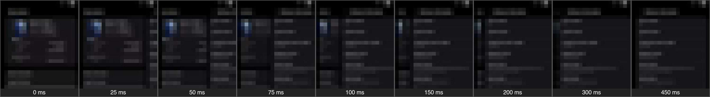
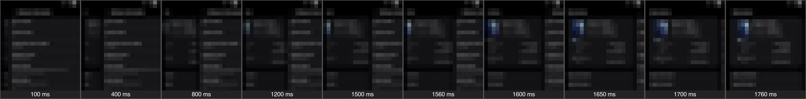
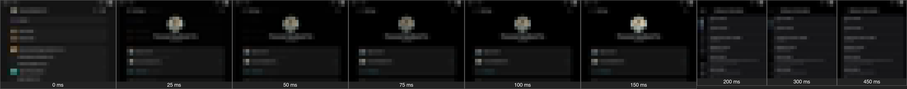
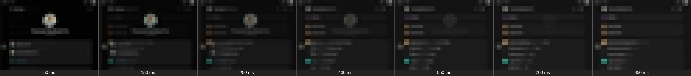
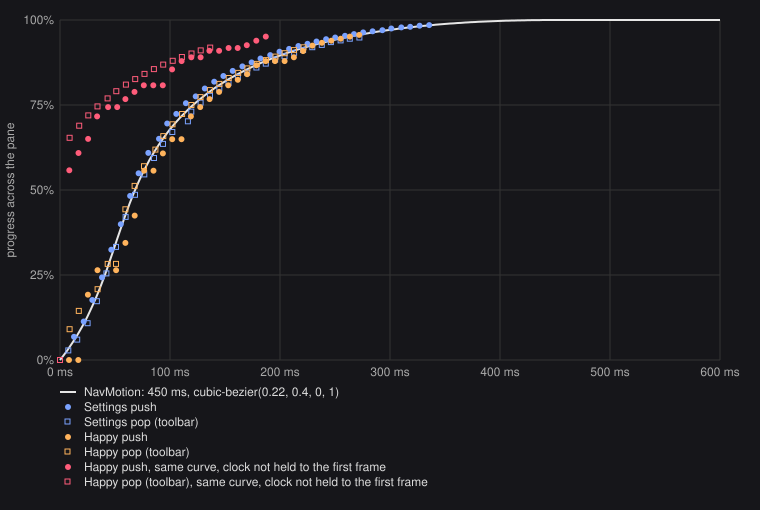
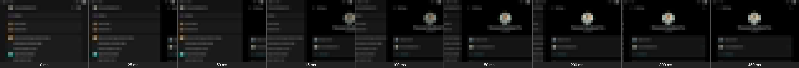
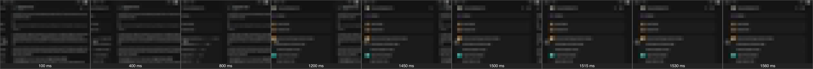

# Page navigation: One UI Settings measured, and ours

Steve on the Fold7: swipe back fades, software and hardware back differ,
forward is basically instant; make it one motion, the Settings app's.
This is what Settings does, measured frame by frame on the device, what
Happy did, and what `ui/NavMotion.kt` does now.

## Setup

- Galaxy Z Fold7 (SM-F966U1), One UI 9.0, Android 17, inner display
  1968×2184 at 420 dpi (2.625 px/dp), 120 Hz, gesture navigation, dark
  mode, animator duration scale 1.
- Settings runs two-pane on the inner display. Its detail pane, where pages
  move, is 1202 px (458 dp) wide. Recorded: About phone › Software
  information (tap), the toolbar ←, `KEYCODE_BACK` (what the three-button
  bar's back sends), and back-gesture swipes from the left edge: slow
  (1.1k px in 1.6 s), cancelled (out to 600 px and back), and a fling
  (700 px in 90 ms).
- `adb screenrecord --display-id 4630946449689556883` at 30 Mbps keeps
  every frame the display composes, with its timestamp (8.3–8.7 ms apart).
- `navigation-motion/scripts/`: `track.py` finds each frame's top page
  by matching the pane against that page at rest at every horizontal
  shift, then the page beneath by shift and brightness gain over the strip
  left of the top page. `fit.py`/`joint.py` fit a start time and
  cubic-bezier to the offsets (Nelder–Mead). `strip.py`/`chart.py` draw
  what's below. The strips are pixelated: the sharp frames show the
  phone's number, IMEI and private chats.

## What Settings does

| | Measured |
|---|---|
| Duration, push and pop | 450 ms (free fits: 453, 456, 450, 414 ms) |
| Curve, push and pop | cubic-bezier(0.214, 0.400, 0, 1.0), one fit over two pushes and two pops: rms 0.7% of the pane. Half the distance is covered by 68 ms, 93% by 225 ms. |
| Page on top | Travels the whole pane width (1202 px), fully opaque from its first frame (brightness ratio to rest 0.96–1.00); no fade, no scale |
| Page beneath | Moves 305–313 px the other way: **26% of the pane**, on the same curve (offset = −0.26 × what the top page has left, within 2%) |
| Dim beneath | Brightness ×0.80 at 88% of a push: **about 20%** at rest beneath. In dark mode a black scrim and a translucent page over black can't be told apart. Light mode was not measured |
| Edge shadow | None measurable: the 20 px next to the top page's edge are as bright as the rest of the page beneath (±5%). On near-black pages a shadow wouldn't show anyway |
| First frame | 13 ms after the motion starts, at 6.8% |
| Toolbar ← vs `KEYCODE_BACK` | The same frames: offsets equal to ±2 px at every frame |
| Back gesture, dragging | The top page follows the gesture's progress, mapped onto the pane: 0.66 px/ms against the finger's 0.69, out to about half the pane, then a quarter of the finger's speed (the system's rubber band). The page beneath is dimmed fully (×0.77–0.82) from the drag's first frame and sits further left than at rest (−364 px against −310), moving at a fifth of the top page's speed |
| Gesture released past the threshold | The rest runs decelerating: from 56% to the edge in 220 ms; a fling from 15% in 270 ms. The page beneath slides home and undims |
| Gesture cancelled | From 14% back to rest in about 100 ms |

**Against Telegram** (the previous `NavMotion`: 150 ms, decelerate(1.5),
48 dp of travel with an alpha fade, the page beneath still): Settings
takes three times as long, slides the whole pane rather than 48 dp,
never fades, and moves and dims the page beneath.

**Against iOS's UINavigationController** (from Apple's behaviour, not
measured here): the same model, the new page across the full width over
an old page that moves about 30% and dims, a gesture that holds the page
under the finger, and commit or cancel from where it is let go. iOS runs
a spring of about 0.5 s, dims less in light mode, and shadows the
incoming edge. Settings is a 450 ms bezier, front-loaded harder (93% done
at half time), with no shadow.

## What Happy did (before)

One NavHost (`HappyApp`, inside `TabletShell` on a tablet) with
`NavMotion`'s Telegram spec for push and pop, and the same pop handed to
navigation-compose's predictive callbacks.

1. **Forward looked instant, for two reasons.** decelerate(1.5) over
   150 ms is 70% done at 50 ms. Compose also starts a transition's clock
   in the frame that composes the new page, and on the Fold that frame
   took 53 ms (10 ms composing, 33 ms laying out and drawing). The next
   frame then landed a third of the way in. Recorded on the Fold, with
   the new curve but without the fix below, a push's first moving frame
   is at 56%, a toolbar pop's at 65%, a key pop's at 43%.
2. **Swipe back faded.** navigation-compose seeks the predictive
   transition to the gesture's progress through the transition's own
   easing. Telegram's pop was 48 dp of slide plus a fade-out on
   decelerate(1.5), so 20% of a drag already took the page about half
   transparent. The page didn't follow the finger either: 48 dp at most.
3. **Software and hardware back differed.** The toolbar ← and the back
   key both pop through `popEnter`/`popExit`; the gesture went through the
   predictive path (eased seek, then a linear finish over the rest of the
   duration). Each also skipped a different amount of its start,
   depending on what the page beneath cost to draw.
4. `AGENTS.md` still described Material's shared X axis (300 ms, 30 dp),
   two specs ago.

Routes and back sources, checked:

- Every screen is a `composable<…>` in the one NavHost: home, settings,
  chats, files, artifacts, the browser, machine and session info, agent
  connection pages, onboarding. All take the NavHost's motion; none set
  their own.
- `popUpTo(…) { inclusive = true }` replacements (chat → its successor,
  compose from a chat, session info → session) are pushes over the page
  they replace. Kept: iOS replaces with a push too.
- Deep links and notification opens go through `DeepLinkEffect` →
  `nav.navigate`, a push.
- An account or agent switch remounts the stack (`key(…)`): no motion,
  as before.
- Screen-level `BackHandler`s close something and let back through: the
  browser's page history, home search, the question banner. They aren't
  predictive, so a gesture there shows no preview. Unchanged.
- The picture viewer is a `Dialog` window: its own back and window
  animation, as iOS's viewer has its own. Unchanged.
- The compose chat becomes a session in place, with no route change and
  no motion. Unchanged.

## What Happy does now (`ui/NavMotion.kt`)

- **Push:** the new page from the pane's end edge, the full width,
  450 ms, cubic-bezier(0.22, 0.4, 0, 1). The old page moves 26% of the
  width toward the start and goes to 80% opacity over black, which
  `Modifier.backdrop` draws behind the NavHost only while two pages are
  up. The result is a 20% dim in both themes, and the window shows
  through nothing at rest.
- **Pop**, from the toolbar ←, the back key, the three-button bar, or a
  gesture's commit: the same motion reversed. `NavMotionTest` checks that
  toolbar and system back draw identical frames.
- **Back gesture:** the pages sit exactly where the gesture's progress
  puts them, linearly, so the drag is the pop scrubbed by the finger.
  Released, the rest runs on the same curve from there (commit, over
  (1 − p) × 450 ms) or back on it (cancel, p × 450 ms). navigation-compose
  finishes a commit by advancing the transition linearly and a cancel on
  FastOutSlowIn; `GestureEasing` knows the finger is down from the
  dispatcher's `transitionState` and redraws what is left on the curve.
- **First frame:** `FromFirstFrame` starts a push's or pop's clock one
  frame before the first sample it draws, so the frame that composes a
  heavy page no longer eats the start. The last 150 ms of slack it adds
  is at rest on the curve.
- RTL mirrors it, from the other edge. On a tablet only the detail pane
  moves. Animator duration scale 0 changes pages at once; other scales
  stretch the time.

| On the Fold | Settings | Happy before | Happy now |
|---|---|---|---|
| Push, first moving frame | 6.8% | fade 70% by 50 ms; 56% with the new curve but no first-frame fix | 3.5%, then 8%, 19% |
| Toolbar pop, first moving frame | 2.8% | 65% (new curve, no fix) | 9% |
| Key pop | = toolbar | 43% (new curve, no fix) | 9%, frames = toolbar |
| Gesture, dragging | page follows progress, beneath fully dimmed | 48 dp and a fade | page follows progress; beneath at 26% × the rest, dimmed in proportion |
| Commit from about 0.5 | 220 ms | n/a | 198 ms (from 0.82: 70 ms measured) |
| Cancel | ~100 ms from 0.14 | n/a | 150 ms measured from 0.38 |

**Where we differ from Settings, on purpose or not yet:**

- Drag: Settings dims the page beneath fully from the drag's first frame,
  starts it further left, and slows the top page past half the pane (the
  system's rubber band for activities). Ours scrubs the very pop the
  buttons run, so a drag looks like a slowed-down button pop. Steve asked
  for that.
- Commit and cancel durations follow the progress, not the fling's
  velocity. A fling from 15% takes 383 ms here against Settings' 270.
- Light mode's dim is unmeasured: 20% black there too.
- Some pages drop frames while they move (a repeated frame or two in the
  settings push above). That is those pages' draw cost, not the motion.
